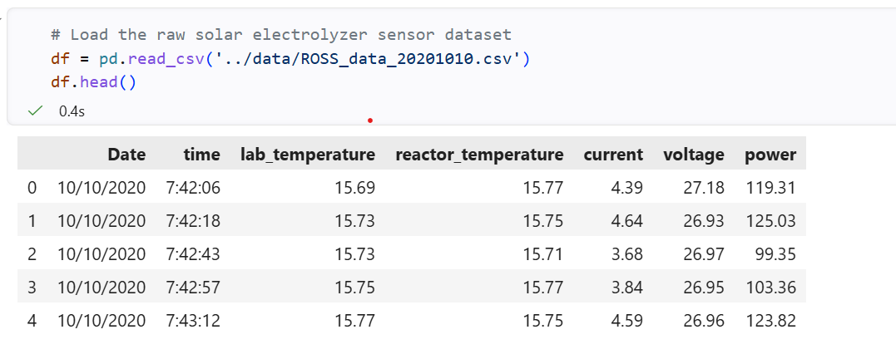

## Electrolyzer Hydrogen Output Modeling 🚀
A small machine learning project that predicts simulated hydrogen output from solar electrolyzer sensor data.

**Important:** The "actual" hydrogen output in this project is **simulated**, not measured. 

## What this project does
1. Cleans sensor data from a solar electrolyzer (one day of readings, 2020-10-10).
2. Calculates **theoretical** hydrogen output with Faraday's law of electrolysis.
 $$H_{2,\text{theoretical}} = \frac{ItM}{zF}$$
4. Simulates **actual** hydrogen output by applying a random efficiency to the theoretical value.
 $$H_{2,\text{actual}} = \frac{\text{efficiency}}{100} \times H_{2,\text{theoretical}}$$
6. Trains and compares three models using a chronological split.


## 📂 Dataset   
- Source: [Kaggle](https://www.kaggle.com/code/faradayeffect/h2-electrolyzer-voltage-vs-current/notebook)  
- Data Dimensions: 2,972 entries tracking  lab temperature, reactor temperature, current, voltage, power, and timestamps.
- After removing 30 upward current spikes, 2,942 rows remained.



## Tech stack
* Language: Python
* Core Libraries: scikit-learn, Xgboost, random forest, linear regression, pandas, Numpy
* Visualization: matplotlib 


## 📈 Results
| Model | MAE (g) | RMSE (g) |
|---|---|---|
| Linear Regression (validation) | 6.53e-5 | 9.62e-5 |
| Random Forest (validation) | 4.28e-5 | 8.49e-5 |
| XGBoost (validation) | 1.36e-4 | 1.80e-4 |

Random Forest had the lowest validation error, so it was the model evaluated on the test set.

------------------------------
## Limitations

- The target is simulated. It is theoretical output multiplied by a random efficiency that is unrelated to any feature. These scores show how well the models reproduce my simulated target, **not** real electrolyzer performance.


## Possible next steps

- Model efficiency as a function of current density (for example, the Ulleberg model) instead of a random value.


------------------------------
## 📁 Repository structure

├── data/  
│   └── electrolyzer_sensor_data.csv        # Raw sensor log file  
├── notebook/  
|   ├── electrolyzer_cleaning_comparison.png 
│   └── hydrogen_prediction_pipeline.ipynb  # Python notebook  
├── random_forest_predictions_over_time.png     
├── raw_electrolyzer_data_from_Faraday_One.png      # Screenshot of the raw data  
└── README.md                            # Project readme (this file)  

------------------------------
## 🚀 How to run 

   1. Clone the repository:  
   ```bash  
   git clone https://github.com/MwithHeart/hydrogen-yield-prediction.git
   ```
   ```bash  
   cd hydrogen-yield-prediction
   ```
   
   2. Install requirements:  
   ```bash  
   pip install scikit-learn xgboost pandas numpy matplotlib seaborn  
   ```  
   
   3. Run the notebook: Open `notebooks/hydrogen_prediction_pipeline.ipynb` in Jupyter Notebook or VS Code and run all cells.


